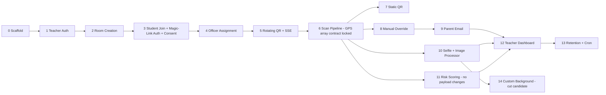

# TangkayScan — Full MVP Build Plan

## Top-Level Overview

**Goal:** Build TangkayScan from scratch — a mobile-first PWA for classroom QR attendance. Teachers create rooms, assign class officers, and pick an attendance mode. Students scan a rotating or static QR to mark attendance. Officers can do manual fallbacks. Parents receive email notifications.

**Scope:** Full greenfield monorepo from scaffold to deployment-ready MVP.

**Approach:** Plain npm workspaces with `apps/web` (Next.js + TypeScript + Tailwind) and `apps/api` (Express + TypeScript). PostgreSQL + Prisma for persistence, Redis for tokens/rate-limits, BullMQ for email queuing, SSE for real-time QR delivery. The 13 MVP steps from the spec are mapped to sub-tasks below, with monorepo scaffold as step 0.

**Resolved open items:**
- Default geofence radius: **100 m**, configurable per room
- Retention window: **30 days** (selfies + GPS logs)
- Manual entries require teacher approval: **on by default**, per-room opt-out
- Static mode session window: **manual open/close only** (no scheduled windows in MVP)
- Monorepo: **plain npm workspaces**, no build orchestrator
- Scan GPS payload: **array of readings** (`readings[0..10]`) locked from Sub-Task 6; Sub-Task 11 adds scoring on top
- Auth: **single server, single JWT secret, `typ` claim** (`'teacher'` | `'student'`); officer role is **never in the JWT** — looked up live in `room_members`; httpOnly SameSite cookies + short-lived access tokens + refresh token
- Student authentication: **magic link / join-code flow** (not password) — many students won't have a personal email; Sub-Task 3 owns this decision
- Custom room background: **dedicated Sub-Task 14** (non-critical path; defer if timeline is tight); `imageProcessor.ts` is shared with selfie flow (Sub-Task 10)

**Frontend note:** Before implementing any frontend screen, pause and ask the user — the design is still being finalised.

---

## Sub-Tasks

---

### Sub-Task 0 — Monorepo Scaffold

**Intent:** Establish the project skeleton so every subsequent sub-task has a working, typed foundation to build on.

**Expected Outcomes:**
- Root `package.json` with `workspaces: ["apps/*"]`
- `apps/api` — Express + TypeScript, running on port 4000, health endpoint `GET /health`
- `apps/web` — Next.js 14 (App Router) + TypeScript + Tailwind CSS, running on port 3000
- Shared `tsconfig` base at root
- `.env.example` files for both apps
- `prisma/schema.prisma` inside `apps/api` with the full data model (draft below)
- Redis client module in `apps/api`
- BullMQ queue module in `apps/api`
- ESLint + Prettier configured at root
- `README.md` updated with setup instructions

**Todo List:**
1. Create root `package.json` with `workspaces` and dev scripts
2. Scaffold `apps/api`: `tsconfig.json`, `src/index.ts`, Express listener, health route
3. Scaffold `apps/web`: `npx create-next-app` with TypeScript + Tailwind, App Router
4. Add root `tsconfig.base.json`; extend in each app
5. Write `apps/api/prisma/schema.prisma` — full data model per spec (see "Data Model" section below)
6. Add `apps/api/src/lib/redis.ts` — ioredis client from env
7. Add `apps/api/src/lib/queue.ts` — BullMQ `emailQueue` definition
8. Write `.env.example` for both apps
9. Configure ESLint + Prettier at root
10. Update `README.md`

**Relevant Context:**
- Data model source: `TangkayScan.md` "Data Model" section plus `rooms` additions from `TangkayScanDesign.md` "Data model additions"
- Tech stack: `TangkayScan.md` "Tech Stack" section

**Status:** [ ] pending

---

### Sub-Task 1 — Teacher Auth (Signup / Login)

**Intent:** Allow teachers to register and authenticate. This gates every other teacher-facing action and establishes the shared JWT pattern used across all roles.

**Expected Outcomes:**
- `POST /api/auth/teacher/signup` — creates teacher, returns `{ accessToken }` in httpOnly SameSite cookie + refresh token cookie
- `POST /api/auth/teacher/login` — validates credentials, sets same cookies
- `POST /api/auth/teacher/refresh` — issues new access token from refresh token
- `POST /api/auth/logout` — clears both cookies
- `GET /api/auth/me` — returns current user from token (checks `typ: 'teacher'` claim)
- Passwords hashed with bcrypt
- JWT middleware reads `typ` claim and rejects mismatched role on guarded routes. **Never trusts a role sent by the client**
- Rate-limit `/login` per IP + email via Redis (e.g., 5 attempts / 15 min)
- Teacher auth pages on the frontend (ask user before building UI)

**Todo List:**
1. Install `bcrypt`, `jsonwebtoken`, `cookie-parser` in `apps/api`
2. Create `apps/api/src/middleware/auth.ts` — cookie extraction, JWT verify, `typ` claim check, attach `req.user`
3. Create `apps/api/src/routes/auth.ts` — teacher signup, login, refresh, logout, me routes
4. Implement short-lived access token (15 min) + long-lived refresh token (7 days), both httpOnly SameSite cookies
5. Add login rate-limit using Redis `INCR` / `EXPIRE` per `ip:email` key
6. Run first Prisma migration: `teachers` table + `refresh_tokens` table (`id, teacher_id, token_hash, expires_at, created_at`)
7. Write integration tests for signup, login, refresh, and logout (happy + error paths)
8. Add `JWT_SECRET`, `JWT_REFRESH_SECRET` to `.env.example`

**Relevant Context:**
- `teachers` table: `id, name, email, password_hash, plan (default 'free'), created_at`
- `plan` field kept for future pricing; always `'free'` in MVP, no payment gate
- Officer role is **not** in the JWT — Sub-Task 4 looks it up live in `room_members`

**Status:** [ ] pending

---

### Sub-Task 2 — Room Creation (with Attendance Mode Presets)

**Intent:** Let teachers create rooms and choose an attendance mode. The mode drives the room's config fields and is the control surface for every downstream validation decision.

**Expected Outcomes:**
- `POST /api/rooms` — creates room, returns room with invite code
- `GET /api/rooms` — list teacher's rooms
- `GET /api/rooms/:id` — get room detail
- `PATCH /api/rooms/:id` — update room settings (geofence, mode, approval toggle, background, etc.)
- Invite code auto-generated (nanoid, URL-safe, 8 chars)
- Mode preset logic: selecting a mode sets `gps_policy`, `selfie_policy`, `qr_type` according to the spec table
- `geofence_radius_m` defaults to `100`
- `require_manual_approval` defaults to `true`
- Frontend room creation screen — pause and ask user before building

**Todo List:**
1. Install `nanoid` in `apps/api`
2. Create `apps/api/src/routes/rooms.ts` — CRUD routes, teacher-auth guarded
3. Add mode-preset mapper: given `attendance_mode`, return default `gps_policy`, `selfie_policy`, `qr_type`
4. Migrate `rooms` table
5. Add `geofence_radius_m` default (100) and `require_manual_approval` default (true) in schema

**Relevant Context:**
- Mode preset table in `TangkayScan.md` "Attendance Modes"
- `rooms` schema in `TangkayScan.md` "Data Model" + `TangkayScanDesign.md` background additions

**Status:** [ ] pending

---

### Sub-Task 3 — Student Invite + Room Join (Magic-Link Auth + Consent Capture)

**Intent:** Allow students to join a room via an invite link and authenticate without a password. Consent is captured at enrollment — required for privacy compliance from day one. Magic-link / join-code flow is chosen because many students (especially younger ones) won't have a personal email.

**Expected Outcomes:**
- `GET /api/rooms/join/:inviteCode` — public; resolves invite code, returns room name + preview (no auth required)
- Student identity flow (magic link):
  - Student provides name + optional email (or parent email if no student email) on the join page
  - `POST /api/auth/student/request-link` — generates a one-time token (Redis TTL 15 min), sends magic-link email to the provided address (or parent's)
  - `GET /api/auth/student/verify/:token` — validates OTP, creates student account if new, sets httpOnly cookie (`typ: 'student'`), redirects to join/consent flow
  - **Fallback for no email:** teacher can generate a join-code (short numeric PIN) per student from their dashboard; student enters it on the join page to authenticate
- `POST /api/rooms/:id/join` — student-auth; creates `room_members` row with `role: 'student'`, `consent_status: 'pending'`
- `POST /api/rooms/:id/consent` — student grants or denies; updates `consent_status`
- `GET /api/auth/student/me` — returns student from cookie
- Same refresh-token pattern as teacher (Sub-Task 1)
- Consent must be `'granted'` before the scan pipeline (Sub-Task 6) allows any attendance record
- Frontend join + consent screen — pause and ask user before building

**Todo List:**
1. Extend `students` table: `magic_link_token_hash (nullable)`, `magic_link_expires_at (nullable)`, `join_code (nullable, 6-digit, hashed)` — migration
2. Migrate `room_members` table
3. Add `POST /api/auth/student/request-link` — generate token, store hash in Redis (`magic:{token}:student`), enqueue magic-link email
4. Add `GET /api/auth/student/verify/:token` — validate against Redis, create/find student, set cookies, clear token
5. Add teacher-facing `POST /api/rooms/:id/members/:studentId/join-code` — generates and returns a short join code (hashed in DB); student submits `POST /api/auth/student/verify-code`
6. Add `POST /api/rooms/:id/join` and `POST /api/rooms/:id/consent` routes
7. Add `GET /api/auth/student/me`, refresh, and logout routes (same cookie pattern as Sub-Task 1)
8. Add consent guard check stub for scan pipeline
9. Add login rate-limit for verification attempts (Redis, per IP)

**Relevant Context:**
- `students`: `id, name, email, parent_email, consent_status, created_at`
- `room_members`: `id, room_id, student_id, role, officer_title, joined_at`
- `TangkayScan.md` "Privacy & compliance": consent captured at enrollment
- Same JWT secret + `typ` claim pattern as Sub-Task 1; no separate student secret

**Status:** [ ] pending

---

### Sub-Task 4 — Officer Assignment

**Intent:** Let teachers designate enrolled students as class officers with a title. Officers unlock the QR-generation and manual-mark flows.

**Expected Outcomes:**
- `POST /api/rooms/:id/officers` — teacher assigns a `room_members` record to role `'officer'` with `officer_title`
- `DELETE /api/rooms/:id/officers/:memberId` — revokes officer role
- `GET /api/rooms/:id/members` — returns member list with roles
- Officer role check middleware reusable in later sub-tasks

**Todo List:**
1. Add officer assignment routes to `rooms.ts` (or split to `rooms/officers.ts`)
2. Create `apps/api/src/middleware/officerGuard.ts` — checks `room_members.role = 'officer'` for the requesting student
3. No new migration needed; `room_members.role` and `officer_title` already in schema

**Relevant Context:**
- `room_members.role ('student' | 'officer')`, `officer_title (nullable)`
- `TangkayScan.md` "Core User Roles": officer is assigned by teacher

**Status:** [ ] pending

---

### Sub-Task 5 — Rotating QR: Redis Rotation + SSE Push

**Intent:** Implement the server-owned rotating QR token (30 s TTL in Redis) and SSE endpoint so officer screens display the same live token. This is the core anti-fraud mechanism for Strict and Balanced modes.

**Expected Outcomes:**
- `POST /api/sessions` — teacher or officer starts an attendance session; captures officer GPS as `origin_lat/lng/accuracy`; stores first token in Redis (`session:{id}:current_token`, TTL 30 s)
- `POST /api/sessions/:id/end` — ends session
- Background job (setInterval or BullMQ repeat) rotates the Redis token every 30 s and broadcasts to all SSE subscribers of that session
- `GET /api/sessions/:id/stream` — SSE endpoint; sends `{ token, expires_at }` on each rotation; officer device renders the QR from this token
- Grace-period key: `session:{id}:prev_token` with a short TTL (e.g., 5 s) to handle scan submitted just before rotation

**Todo List:**
1. Migrate `attendance_sessions` table
2. Create `apps/api/src/routes/sessions.ts` — start, end, stream routes
3. Create `apps/api/src/lib/tokenRotator.ts` — rotation logic: generate token (nanoid 16), write `current` + `prev` keys to Redis, notify SSE subscribers
4. Create `apps/api/src/lib/sseManager.ts` — per-session subscriber map, `subscribe(sessionId, res)`, `broadcast(sessionId, data)`, cleanup on `res.close`
5. Wire SSE headers: `Content-Type: text/event-stream`, `Cache-Control: no-cache`, `X-Accel-Buffering: no` (for Nginx)
6. Validate that multiple officer connections all receive the same token

**Relevant Context:**
- `TangkayScan.md` "Rotating QR modes" workflow and "Key Design Decisions — Rotating QR"
- Redis key pattern: `session:{id}:current_token`, `session:{id}:prev_token`
- Nginx SSE config note: `proxy_buffering off`

**Status:** [ ] pending

---

### Sub-Task 6 — Student Scan → Validation Pipeline → Record Attendance

**Intent:** Implement the core scan submission and ordered validation pipeline. This is the central business logic of the app.

**GPS payload contract (locked here, not revisited in Sub-Task 11):**
```typescript
// Client sends exactly this shape — never changed later
interface ScanPayload {
  token: string;
  readings: Array<{        // 0–10 entries from watchPosition (~3-4 s window)
    lat: number;           // bounded [-90, 90]
    lng: number;           // bounded [-180, 180]
    accuracy: number;      // metres
    altitude: number | null;
    speed: number | null;
    heading: number | null;
    timestamp: number;     // ms epoch
  }>;
  client_time: number;     // ms epoch — for clock-delta signal in Sub-Task 11
  device_fingerprint: string;
  // selfie added in Sub-Task 10 as multipart field
}
// Max timestamp spread across readings: 10 s
// Empty readings array is valid — server records location_flag: 'unverified'
// Retrying the same scan (offline queue) returns idempotent 'already_recorded'
```

**Expected Outcomes:**
- `POST /api/sessions/:id/scan` — student-auth, accepts `ScanPayload` above
- Server picks **one representative reading** for Haversine (lowest `accuracy` value = best fix, or median if tie); stores full `readings` array in a JSON column for Sub-Task 11
- Pipeline runs in order:
  1. Auth + membership + consent (`typ: 'student'` claim, enrolled in room, `consent_status: 'granted'`)
  2. Session open
  3. Token check (current or prev grace-period token from Redis)
  4. Duplicate check (idempotent `200 already_recorded` — safe for offline-queue retries)
  5. Geofence (Haversine on representative reading; threshold = `geofence_radius_m + origin_accuracy + student_accuracy`; behaviour per `gps_policy`; empty readings → `location_flag: 'unverified'`)
  6. Risk signals stub (returns `{ score: 'low', signals: [] }` — replaced in Sub-Task 11)
  7. Selfie policy check stub (pass-through — replaced in Sub-Task 10)
  8. Persist `attendance_records` row (store `gps_readings` JSON column)
  9. Enqueue parent email stub (replaced in Sub-Task 9)
- Returns `{ status: 'recorded' | 'already_recorded' | 'flagged', record_id }`
- Scan endpoint rate-limited per student+session via Redis

**Todo List:**
1. Extend `attendance_records` migration to add `gps_readings JSON` column
2. Create `apps/api/src/lib/scanPipeline.ts` — ordered check functions, each returns `{ pass, flag?, reject?, reason? }`
3. Add `ScanPayload` TypeScript interface with Zod validation (bounds-check lat/lng, `readings.length <= 10`, timestamp spread ≤ 10 000 ms)
4. Implement Haversine + representative-reading selector in `apps/api/src/lib/geo.ts`
5. Create `apps/api/src/routes/scan.ts` — validates payload, calls pipeline, persists result
6. Handle `gps_policy: 'warn'` (flag + allow) vs `'reject'` (block) in geofence step; empty readings → `location_flag: 'unverified'` and policy-based pass/reject
7. Add scan-rate Redis key (`scan_rate:{session_id}:{student_id}`, TTL 5 s) to guard rapid retries before duplicate check fires
8. Write pipeline unit tests: each check function in isolation, and happy-path end-to-end

**Relevant Context:**
- `TangkayScan.md` "Scan Validation Pipeline" — exact ordered steps
- `TangkayScan.md` "Geofencing" — threshold formula
- `attendance_records` schema in `TangkayScan.md` "Data Model"

**Status:** [ ] pending

---

### Sub-Task 7 — Static QR Mode

**Intent:** Implement the cheaper, printable-QR variant. Identity comes from login rather than the QR; the teacher manually opens/closes the session window.

**Expected Outcomes:**
- `POST /api/rooms/:id/static-session/open` — teacher opens static session; creates `attendance_sessions` row
- `POST /api/rooms/:id/static-session/close` — teacher closes it
- `POST /api/rooms/:id/static-qr/regenerate` — generates a new signed `static_qr_token` (JWT signed with room secret + server secret); invalidates old one
- `GET /api/rooms/:id/static-qr` — returns printable QR page data (token + room name)
- Scan validation uses same pipeline (Sub-Task 6) but token check validates the JWT signature against `rooms.static_qr_token` instead of Redis
- Class officer can manually log another student (tied to manual-fallback flow in Sub-Task 8)

**Todo List:**
1. Add `static_qr_token` generation to room routes
2. Extend `tokenCheck` pipeline step to branch on `qr_type: 'static'` vs `'rotating'`
3. Add `open`/`close` session routes for static mode (no officer GPS — no origin; use `anchor_lat/lng` from room)
4. Add printable QR route/page (frontend: ask user before building)
5. Add room anchor GPS setting to `PATCH /api/rooms/:id`

**Relevant Context:**
- `TangkayScan.md` "Static QR mode" workflow
- `rooms.static_qr_token`, `anchor_lat`, `anchor_lng`, `session_window` (nullable; not used in MVP — manual only)

**Status:** [ ] pending

---

### Sub-Task 8 — Officer Manual Override + In-App Camera + Audit Log

**Intent:** Give officers a way to mark absent/phone-less students present manually, with a captured photo and a full audit trail visible to the teacher.

**Expected Outcomes:**
- `POST /api/sessions/:id/manual` — officer-auth; accepts `{ student_id, photo_data_url }`; creates `attendance_records` row with `method: 'manual'`, `marked_by_officer_id`, device info
- If `room.require_manual_approval = true`, record saved as `approval_status: 'pending'`; teacher is notified
- `PATCH /api/sessions/:sessionId/records/:recordId/approve` — teacher approves or rejects
- Teacher dashboard can see all manual entries with officer name, timestamp, photo
- Parent email queued after approval (or immediately if approval not required)

**Todo List:**
1. Create `apps/api/src/routes/manual.ts` — manual mark + approval routes
2. Save officer photo to EC2 local disk under a non-public path; store path in `selfie_url`
3. Add device-info capture (user-agent) to the record
4. Wire approval routing: if `require_manual_approval`, set `approval_status: 'pending'` and emit teacher notification (stub notification for now)
5. Extend parent email enqueue to fire on approval (or on record creation if approval off)

**Relevant Context:**
- `TangkayScan.md` "Manual fallback" workflow
- `attendance_records.method`, `marked_by_officer_id`, `approval_status`
- File storage: EC2 local disk, auth-gated route

**Status:** [ ] pending

---

### Sub-Task 9 — Parent Email via Nodemailer + BullMQ

**Intent:** Deliver parent notifications reliably and throttled. Email is the only reliable channel for parents who have no app login.

**Expected Outcomes:**
- `apps/api/src/workers/emailWorker.ts` — BullMQ worker that processes the `emailQueue`
- Nodemailer transport configured with Gmail SMTP + App Password
- Email template: student name, room name, time, method (`QR scan` / `Manual by [Officer]`)
- Rate-limited: BullMQ concurrency 1–2 and `limiter` option to stay under Gmail 500/day
- `attendance_records.parent_notified_at` updated on successful send
- Graceful retry on SMTP error (exponential backoff)

**Todo List:**
1. Install `nodemailer`, `@types/nodemailer`
2. Create `apps/api/src/lib/mailer.ts` — Nodemailer transport from env
3. Create `apps/api/src/workers/emailWorker.ts` — BullMQ processor; send email; update `parent_notified_at`
4. Create email template (plain text + HTML, no external asset links — must render on mobile email clients)
5. Add Gmail SMTP env vars to `.env.example`
6. Replace email stubs from Sub-Task 6 and 8 with real `emailQueue.add()` calls

**Relevant Context:**
- `TangkayScan.md` "Gmail SMTP limits" — throttle via BullMQ, ~500/day cap
- `students.parent_email`, `attendance_records.parent_notified_at`

**Status:** [ ] pending

---

### Sub-Task 10 — Selfie Capture (Per-Mode Policy)

**Intent:** Implement in-browser selfie capture with camera API and server-side storage, gated by the room's `selfie_policy`.

**Expected Outcomes:**
- Frontend: `getUserMedia({ video: { facingMode: 'user' } })` → capture frame → upload as `multipart/form-data` with scan payload
- Backend: receive image, validate file signature (no SVG/animated), resize to ≤ 1600 px long edge, re-encode to WebP quality 80, strip EXIF, store under non-public path
- `selfie_url` saved on `attendance_records`; served via auth-gated route or short-lived signed URL
- Policy enforcement: `selfie_policy: 'required'` — reject scan if no selfie; `'optional'` — accept without; `'off'` — ignore
- Works in plain mobile Safari (requires HTTPS + user gesture)

**Todo List:**
1. Install `sharp` in `apps/api` for image processing
2. Create `apps/api/src/lib/imageProcessor.ts` — validate, resize, strip EXIF, encode to WebP
3. Add `POST /api/upload/selfie` (or accept inline in scan route as multipart) — auth-gated
4. Add `GET /api/selfies/:filename` — auth-gated serving route (teacher/officer can view; students can view own only)
5. Extend scan pipeline selfie step from stub to real enforcement
6. Frontend selfie capture component — pause and ask user before building

**Relevant Context:**
- `TangkayScan.md` "Selfie capture" design decisions
- `TangkayScan.md` "Privacy & compliance": selfies served via auth-gated route, never public
- File storage: EC2 local disk, same non-public pattern as officer photos

**Status:** [ ] pending

---

### Sub-Task 11 — Risk Signal Scoring (GPS + Device Fingerprint)

**Intent:** Implement the heuristic fraud-signal system so the teacher can see explainable flags on suspicious records. The GPS payload contract was locked in Sub-Task 6 (`readings[]` + `client_time`), so no client or endpoint changes are needed here — only the scorer logic replaces the stub.

**Expected Outcomes:**
- `apps/api/src/lib/riskScorer.ts` — accepts `{ readings, client_time, device_fingerprint, ip_address, sessionId }` (all already present on the record); returns `{ score: 'low'|'medium'|'high', signals: string[] }`
- Signals implemented (each a named function, composable):
  - `constantAccuracy` — all readings have identical accuracy value
  - `allNullSensors` — altitude, speed, heading all null or 0 across every reading
  - `identicalCoords` — all lat/lng identical (real GPS jitters)
  - `impossibleJump` — Haversine between consecutive readings exceeds plausible walking speed
  - `clockDelta` — `|client_time - server_time| > threshold` (e.g., 2 min)
  - `ipGeoMismatch` — IP geolocation city/country vs GPS coords (HTTP call to ip-api.com, 1 s timeout, fail-open — soft signal only)
  - `fingerprintCollision` — same `device_fingerprint` already on a different `student_id` record in this session
- No client or endpoint changes — `readings` and `client_time` already stored (Sub-Task 6)
- `risk_score` and `risk_signals` updated on the `attendance_records` row (replace stub values)
- Strict mode enforcement: `high` → reject scan (pipeline returns `reject: true`), `medium` → flag only

**Todo List:**
1. Create `apps/api/src/lib/riskScorer.ts` — each signal as a standalone named function; aggregate to `low/medium/high` threshold (e.g., ≥2 signals = medium, ≥4 = high — tune after real-world testing)
2. Add IP geolocation helper: `apps/api/src/lib/ipGeo.ts` — wraps ip-api.com call, 1 s timeout, fail-open (returns null on failure)
3. Add `fingerprintCollision` check: single Prisma query for other records in the session with same fingerprint and different student
4. Replace risk signal stub in `scanPipeline.ts` with `riskScorer` call
5. Add Strict mode enforcement branch in pipeline: `score === 'high'` → `reject`, `score === 'medium'` → `flag`
6. Write unit tests for each signal function with mock readings

**Relevant Context:**
- `TangkayScan.md` "GPS Spoofing / Mock Location" — full signal list and policy
- `attendance_records.gps_readings` JSON column added in Sub-Task 6 — data is already there
- Strict mode policy: `risk_score: 'high'` → reject, `'medium'` → flag

**Relevant Context:**
- `TangkayScan.md` "GPS Spoofing / Mock Location" — full signal list and policy
- Strict mode policy: `risk_score: 'high'` → reject, `'medium'` → flag

**Status:** [ ] pending

---

### Sub-Task 12 — Teacher Dashboard (Attendance List, Flags, Approvals)

**Intent:** Give teachers visibility into attendance, fraud flags, and manual-entry approvals. This is the main teacher-facing data surface.

**Expected Outcomes (API):**
- `GET /api/rooms/:id/sessions` — list sessions with summary (present count, flagged count)
- `GET /api/sessions/:id/records` — paginated attendance records with student name, method, flags, risk score, signals
- `GET /api/sessions/:id/records?filter=flagged` — flagged-only view
- `GET /api/sessions/:id/records?filter=pending_approval` — pending manual entries
- `PATCH /api/sessions/:sessionId/records/:recordId/approve` (already in Sub-Task 8, reused here)

**Expected Outcomes (Frontend):**
- Ask user before building any frontend screens

**Todo List:**
1. Create `apps/api/src/routes/dashboard.ts` — session list + record list routes
2. Add pagination (cursor-based or offset; 20 per page)
3. Add filter query param support (`flagged`, `pending_approval`, `all`)
4. Add record detail endpoint including `risk_signals` array for explainability

**Relevant Context:**
- `TangkayScan.md` "MVP Build Order" step 12
- `attendance_records` schema — `location_flag`, `risk_score`, `risk_signals`, `approval_status`

**Status:** [ ] pending

---

### Sub-Task 13 — Retention Cleanup + Backup Cron Jobs

**Intent:** Implement the privacy-mandated 30-day retention policy for selfies and GPS logs, and establish a nightly EC2 backup routine.

**Expected Outcomes:**
- Cron job (node-cron inside Express process, or PM2 cron): runs daily, deletes selfie files older than 30 days, nullifies `selfie_url`, `student_lat`, `student_lng`, `student_accuracy` on matching records
- Nightly backup script: rsync selfie directory to a backup path on EBS; log success/failure
- PM2 ecosystem config (`ecosystem.config.js`) at `apps/api` — Express process + worker process
- Nginx config snippet (`nginx.conf.example`) with SSE settings (`proxy_buffering off`, extended read timeout)

**Todo List:**
1. Install `node-cron` in `apps/api`
2. Create `apps/api/src/jobs/retentionCleanup.ts` — query records where `scanned_at < now - 30 days`, delete files, null out fields
3. Create `apps/api/scripts/backup.sh` — rsync selfie dir, log output, intended for crontab
4. Write `apps/api/ecosystem.config.js` — two entries: `api` (Express) and `email-worker` (BullMQ worker)
5. Write `nginx.conf.example` — reverse proxy to port 4000, SSE directives, SSL placeholder
6. Document all ops steps in `README.md`

**Relevant Context:**
- `TangkayScan.md` "EC2 ops checklist" and "Privacy & compliance" (30-day retention)
- `TangkayScan.md` "Key Design Decisions — Privacy": GPS coordinates count as sensitive data

**Status:** [ ] pending

---

### Sub-Task 14 — Custom Room Background Image

**Intent:** Let teachers personalise their room with an uploaded photo background. Non-critical path — can be cut if the one-month deadline is tight; schema columns are already in place from Sub-Task 0 so deferring doesn't break anything.

**Expected Outcomes:**
- `POST /api/rooms/:id/background` — teacher uploads image; server validates file signature (accept `jpeg`, `png`, `webp`; reject SVG and animated formats), resizes to ≤ 1600 px long edge, re-encodes to WebP quality ~80, strips all EXIF metadata (GPS, device, timestamps), generates a tiny blurred placeholder (data URI), stores under non-public EC2 path, computes average luminance and sets `background_scrim` (`'light'` or `'dark'`) automatically
- `DELETE /api/rooms/:id/background` — reverts to default; deletes old file from disk
- Old file deleted on replace (cap one active custom background per room)
- `GET /api/rooms/:id/background-image` — auth-gated, cacheable route with versioned filename (`Cache-Control: immutable` on the processed file)
- PWA service worker caches processed image for offline use (frontend concern)
- `PATCH /api/rooms/:id` extended to accept `background_dim`, `background_blur`, `background_scrim` override, `background_preset_id`, `background_type`
- Preset backgrounds: a small set of built-in soft-texture images (bundled with the app, no upload needed)
- Moderation: `POST /api/rooms/:id/background/report` — any enrolled student or officer; flags the room for admin review; admin can `DELETE /api/admin/rooms/:id/background` to remove and revert to default
- `imageProcessor.ts` from Sub-Task 10 is **reused directly** — no duplication

**Todo List:**
1. Extend `imageProcessor.ts` (Sub-Task 10) with EXIF stripping via `sharp`'s `.withMetadata(false)` and luminance computation (average pixel brightness → `'light'` or `'dark'` scrim choice)
2. Add `POST /api/rooms/:id/background` — `multer` for upload, call `imageProcessor`, write file, update room row
3. Add `DELETE /api/rooms/:id/background` and file-cleanup logic (reusable `deleteFile` utility)
4. Add `GET /api/rooms/:id/background-image` — stream file through auth guard; set `Cache-Control: public, max-age=31536000, immutable` (versioned by file hash in name)
5. Add `POST /api/rooms/:id/background/report` — creates a `background_reports` table row (`id, room_id, reported_by_student_id, created_at`)
6. Add admin route `DELETE /api/admin/rooms/:id/background` — teacher/admin auth; deletes file and resets room background fields
7. Bundle built-in preset images under `apps/api/assets/presets/`; `background_preset_id` maps to a filename
8. Frontend preview with Dim + Blur sliders — pause and ask user before building

**Relevant Context:**
- `TangkayScanDesign.md` "Custom Background Image" — full behaviour, readability rules, upload constraints, safety and moderation
- `rooms` background columns already in schema from Sub-Task 0: `background_type`, `background_preset_id`, `background_image_path`, `background_placeholder`, `background_dim`, `background_blur`, `background_scrim`
- `imageProcessor.ts` shared with Sub-Task 10 (selfie flow) — resize, re-encode, signature validation already implemented there
- **Cut candidate:** if timeline is tight, ship with presets only (`background_type: 'preset'` or `'none'`); defer `'custom'` upload. Schema is already in place.

**Status:** [ ] pending

---

## Data Model Reference

Full schema (consolidated from `TangkayScan.md` + `TangkayScanDesign.md`):

```
teachers
  id, name, email, password_hash, plan (default 'free'), created_at

rooms
  id, teacher_id, name, invite_code,
  attendance_mode ('strict' | 'balanced' | 'static' | 'manual'),
  qr_type ('rotating' | 'static'),
  static_qr_token (nullable),
  anchor_lat, anchor_lng (nullable),
  geofence_radius_m (default 100),
  gps_policy ('off' | 'warn' | 'reject'),
  selfie_policy ('off' | 'optional' | 'required'),
  require_manual_approval (bool, default true),
  session_window (nullable — reserved, not used in MVP),
  background_type ('none' | 'preset' | 'custom'),
  background_preset_id (nullable),
  background_image_path (nullable),
  background_placeholder (nullable),
  background_dim (0-100, default 35),
  background_blur (0-20, default 0),
  background_scrim ('light' | 'dark'),
  created_at

students
  id, name, email, parent_email,
  consent_status ('pending' | 'granted' | 'denied'), created_at

room_members
  id, room_id, student_id, role ('student' | 'officer'),
  officer_title (nullable), joined_at

attendance_sessions
  id, room_id, started_by_officer_id (nullable),
  origin_lat, origin_lng, origin_accuracy,
  status ('active' | 'ended'), started_at, ended_at

attendance_records
  id, session_id, student_id,
  method ('qr_scan' | 'manual'),
  marked_by_officer_id (nullable),
  approval_status ('approved' | 'pending' | 'rejected'),
  selfie_url (nullable),
  student_lat, student_lng, student_accuracy,
  gps_readings (JSON — full watchPosition array, retained for risk scoring),
  distance_from_origin_m,
  location_flag ('verified' | 'unverified' | 'mismatch'),
  risk_score ('low' | 'medium' | 'high'),
  risk_signals (JSON),
  device_fingerprint, ip_address,
  scanned_at, parent_notified_at (nullable)

refresh_tokens
  id, teacher_id (nullable), student_id (nullable),
  token_hash, expires_at, created_at

background_reports  (Sub-Task 14)
  id, room_id, reported_by_student_id, created_at
```

---

## Architecture Overview

```
apps/
  api/                   Express + TypeScript
    prisma/              schema.prisma, migrations
    src/
      index.ts           server entry
      routes/            auth, rooms, sessions, scan, manual, dashboard, upload, admin
      middleware/        auth.ts, officerGuard.ts
      lib/               redis.ts, queue.ts, sseManager.ts, tokenRotator.ts
                         scanPipeline.ts, geo.ts, riskScorer.ts, ipGeo.ts
                         imageProcessor.ts, mailer.ts
      workers/           emailWorker.ts
      jobs/              retentionCleanup.ts
      scripts/           backup.sh
    assets/presets/      built-in background images
    ecosystem.config.js
    nginx.conf.example
  web/                   Next.js 14 App Router + Tailwind
    app/
      (teacher)/         teacher route group
      (officer)/         officer route group
      (student)/         student route group
      (auth)/            login, magic-link verify, join pages
    components/
    lib/
```

---

## Implementation Order (matches sub-task numbering)


